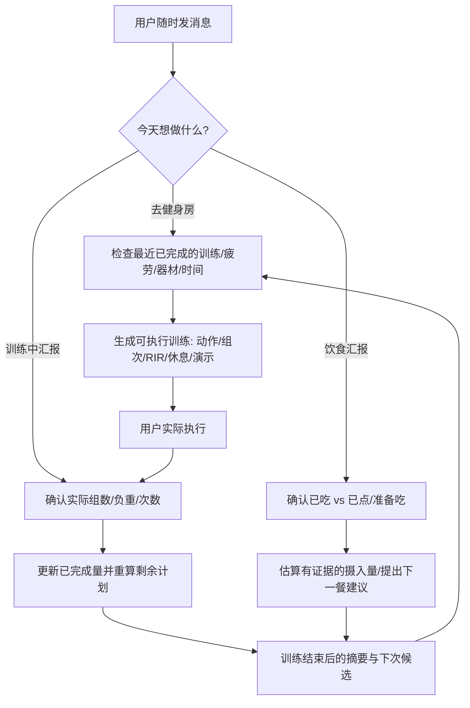

# 🏋️ Rolling Fitness Coach

**A state-aware AI fitness coach that adapts to real workouts, nutrition, recovery, and real life.**  |  **一个真正跟着你调整计划的 AI 私人健身与营养教练。**

> **Train when you can. Log what you actually did. Let the plan adapt.**  
> 不需要固定每周二或周五健身。你有时间就来，记录实际完成的训练与饮食，下一次计划随之更新。

[中文说明](#中文--为什么需要它) · [English guide](README_EN.md) · [Installation & mobile](docs/INSTALL.md) · [Skill source](SKILL.md) · [Evaluation scenarios](evals/evals.json)

## 中文 · 为什么需要它？

大部分健身计划是静态表格：周一练胸、周三练背、周五练腿。但现实并不配合——工作忙、健身房排队、肩膀还没恢复、训练进行到一半得离开、昨天吃得不够，甚至对某个动作找不到正确发力。

**Rolling Fitness Coach** 是一个符合 [Agent Skills](https://agentskills.io/specification) 约定的可复用工作流。它以**实际完成量、恢复状况、当下目标、可用时间和器材**为决策依据，实时生成或调整训练，同时处理不定时饮食汇报。它不预设每次训练都按原计划完成。

### ✨ 核心功能

| 能力 | 你可以这样说 | Skill 应当做什么 |
| --- | --- | --- |
| 🧭 个性化体型评估 | “这是我近期的照片和体脂秤数据，我想练薄肌。” | 谨慎分析可见体型和目标肌群，不谎称量出了精确体脂率/骨架尺寸。 |
| 🗓️ 滚动日程 | “我今天突然有40分钟，上次练了胸。” | 根据最近真实训练和恢复情况安排今天，而非固定 A/B 日历。 |
| 🏋️ 现场教练 | “我刚完成侧平举2组，现在肩膀累了。” | 登记真实两组，重算剩余训练；不强迫凑满计划。 |
| 🔄 器械替换 | “腿举排队太长，旁边只有哑铃。” | 提供相同运动模式的替代，说明动作差异与技术要点。 |
| 🎯 技术纠错 | “推胸时感觉二头代偿。” | 检查座位高度、关节轨迹、负重、控制与疼痛信号。 |
| 🎥 动作演示 | “每个动作附图片/视频，休息多长？” | 当宿主支持联网与视觉工具时引用可核查素材；不虚构视频 URL。 |
| 🍌 滚动饮食日志 | “早餐燕麦，点了咖啡但还没喝。” | 只把确认摄入的食物计入摄入量；说明不确定份量。 |
| 📈 进步复盘 | “这几周训练没进步，怎么办？” | 检查训练量、重量/次数/RIR、疲劳、睡眠及饮食，给最小必要调整。 |

### 🧠 与一次性训练计划的区别



### 📱 典型的完整使用场景

**初始建档：** “我是有6个月训练经验的健身者，每周通常能练2次，时间不固定。我希望增加肩部与上胸肌肉，整体保持精瘦。”

**训练前：** “现在到健身房了，只有45分钟，昨天训练过背部，肩膀没有疼痛。请给我今天的动作、组数、休息和动作要点。”

**现场变更：** “器械都被占了，我做完机器推胸3组，现在只剩18分钟。附近有哑铃和绳索。”

**训练后：** “今天实际完成：胸推30kg 12/10/9；侧平举5kg 16/14；腿举70kg 12/11。肩膀疲劳6/10。”

**饮食：** “午餐吃了米饭、鸡肉和蔬菜，量没有称。晚饭前还要训练。”

它会依据**已确认的实际信息**继续工作；不知道的数据保持未知，不把训练计划当训练记录，也不把没汇报的餐食当作零摄入。

### 🚀 安装（特别注意 ChatGPT 手机端）

此仓库包含 **Agent Skill 源代码**，GitHub 下载、克隆或拥有 `.skill` 文件**并不会自动在 ChatGPT 插件列表中安装**。

1. **支持 Skills 的 ChatGPT 账户 / 工作空间：** 在 ChatGPT `Plugins → Skills` 寻找 `Create`，按界面提供的方式上传包或通过编辑器创建。Skills 可用性由套餐、工作空间和客户端决定；请以 [官方帮助](https://help.openai.com/en/articles/20001066-skills-in-chatgpt) 为准。
2. **ChatGPT 私人 Plugin：** 可以把本 Skill 封装为只含 Skill 的 Plugin。账户中的插件通常可在手机端的 `Plugins → Personal/Installed` 查找，具体能力及可见性因客户端、套餐而异。参见 [Plugins in ChatGPT](https://help.openai.com/en/articles/20001256-plugins-in-chatgpt)。
3. **Codex / 兼容 Agent Skills 的工具：** 将整个 Skill 文件夹添加到宿主支持的 Skills 目录，并遵循对应宿主的安装说明。
4. **仅聊天使用：** 可以直接将 `SKILL.md` 和 `references/` 提供给支持长上下文的助手，但不会自动获得持久储存或定时提醒。

👉 详细步骤与常见疑问见 [docs/INSTALL.md](docs/INSTALL.md)。

### 📁 项目结构

```text
rolling-fitness-coach/
├── SKILL.md                 # 主入口 / 行为约束
├── README.md                # 中文详细说明
├── README_EN.md             # English guide
├── docs/INSTALL.md          # ChatGPT / 手机 / Agent 安装与限制
├── references/
│   ├── intake-visual-assessment.md
│   ├── training-engine.md
│   ├── nutrition-engine.md
│   ├── exercise-demos.md
│   ├── interaction-templates.md
│   ├── data-model.md
│   ├── safety-privacy.md
│   └── requirements-traceability.md
├── assets/                  # 完全虚构的输入数据示例与空白状态
├── scripts/coach_log.py     # 可选：本地 JSON 训练/饮食记录器
├── tests/test_coach_log.py
├── evals/evals.json         # 行为评测场景（非线上模型评测结果）
├── .gitignore
├── CONTRIBUTING.md
└── LICENSE                  # MIT
```

### 🔧 本地运行日志工具（可选）

Python 3.9+，仅使用标准库；记录默认只写入你自己指定的本地 JSON 文件。

```bash
python scripts/coach_log.py init --file athlete.json
python scripts/coach_log.py add-workout --file athlete.json --input assets/workout.example.json
python scripts/coach_log.py add-food --file athlete.json --input assets/food.example.json
python scripts/coach_log.py summary --file athlete.json --days 14
python -m unittest discover -s tests -v
```

> `assets/*.example.json` 为**虚构测试数据**。在真实使用时请把输入换成你实际完成、已经确认的数据。本地 CLI 本身不是 AI 聊天引擎。

### 🔐 隐私、安全及科学边界

- **没有真实个人数据**：不包含开发者/用户照片、姓名、真实训练记录、私人对话截图或医疗资料。请不要把自己的 `athlete.json` 等日志提交到公开仓库。
- **训练 ≠ 医疗**：疼痛、突发胸闷、晕厥等情况不应通过“换个动作继续练”来解决；请按情况停止运动并寻求专业评估。
- **估计 ≠ 实测**：照片不能精确测量体脂、骨宽；未报重量、卡路里或咖啡因不应被编造。
- **没有隐藏后台能力**：本 Skill 不会独立监控用户、自动发提醒、永久跨聊天记忆或云端同步。相应能力取决于宿主及用户授权。
- **图文示范由宿主提供**：本仓库不打包受版权保护的训练视频或图片；能检索时提供引用和来源链接。

### 🧪 质量保证与路线图

- `tests/`：验证本地训练/饮食日志和统计边界（用户输入不完整、已点未喝、热身组等）。
- `evals/evals.json`：一组针对 AI 决策行为的**待运行评测用例**，不可把它们误称为已通过的模型级测试。
- 下一阶段可加入：跨设备同步（经用户授权）、更完备的动作示范来源、历史训练体积可视化、持续性行为评测及健身房器械库。

欢迎通过 GitHub Issues 提交案例、改进建议和匿名反馈。**不要在公开 Issue 中上传私人健康信息或可识别的照片。**

## License

[MIT](LICENSE). Educational and lifestyle coaching, not a substitute for medical care.
