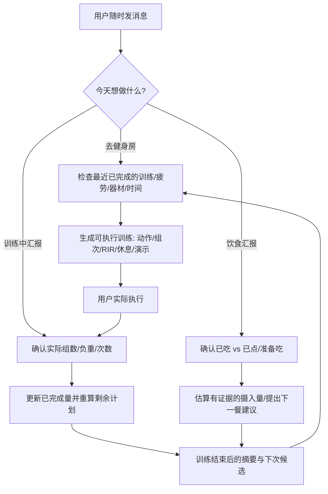

# 🏋️ Rolling Fitness Coach

**A state-aware AI fitness coach that adapts to real workouts, nutrition, recovery, and real life.**  |  **一个真正跟着你调整计划的 AI 私人健身与营养教练。**

> **Train when you can. Log what you actually did. Let the plan adapt.**  
> 不需要固定每周二或周五健身。你有时间就来，记录实际完成的训练与饮食，下一次计划随之更新。

[🚀 立即体验](#-立即体验无需安装不用懂-skill) · [English](README_EN.md) · [安装与手机使用](docs/INSTALL.md) · [Skill 源码](SKILL.md) · [Evaluation scenarios](evals/evals.json)

## 🆕 v1.2.1 · ChatGPT 对话内 Intelligent UI

本次更新**只改进 ChatGPT 聊天中的原生交互形式**，不开发网站，也不需要部署：

- **训练开始前**：可选输入当天体重（kg/斤）、称重条件、可用训练分钟和恢复状态；用户消息中已经提供的无需重复填写。
- **训练进行中**：直接在当前 ChatGPT 回复中逐组记录每组**实际重量、次数、RIR 和完成状态**，每组可以不同重量；可以替换被占用器械及增减组。
- **完成后**：点击聊天中的提交按钮，将本次真实输入作为同一对话的新消息，教练按已完成组分析进步并调整剩余计划。
- **腹肌固定覆盖**：在每次有限训练时间内合理安排约2–3组腹肌/核心训练。
- **能力边界**：宿主不支持原生控件时回退为同一聊天的文本记录；没有自动云同步、自动永久记忆或 SQLite 后端。

**不需要打开 GitHub 网页记录训练、下载新 App、部署 HTML/CSS/JS 或设置服务器。** 详情：[聊天原生 UI 规范](references/interactive-ui.md) · [滚动训练引擎](references/training-engine.md)。

## 🚀 立即体验（无需安装、不用懂 Skill）

### **[▶ 点击这里，在 ChatGPT 开始私人健身教练对话](https://chatgpt.com/?q=%E8%AF%B7%E4%BD%9C%E4%B8%BA%20Rolling%20Fitness%20Coach%20%E5%8A%A8%E6%80%81%E7%A7%81%E4%BA%BA%E5%81%A5%E8%BA%AB%E4%B8%8E%E8%90%A5%E5%85%BB%E6%95%99%E7%BB%83%E3%80%82%E5%85%88%E8%AF%BB%E5%8F%96%E5%85%AC%E5%BC%80%20Skill%20%E6%8C%87%E4%BB%A4%EF%BC%9Ahttps%3A%2F%2Fraw.githubusercontent.com%2FAngusliu6%2Fyour-rolling-fitness-coach-%2Fmain%2FSKILL.md%20%EF%BC%8C%E5%B9%B6%E5%9C%A8%E9%9C%80%E8%A6%81%E6%97%B6%E5%8F%82%E7%85%A7%E8%AF%A5%E4%BB%93%E5%BA%93%20references%2F%20%E4%B8%8B%E7%9A%84%E7%9B%B8%E5%BA%94%E8%AF%B4%E6%98%8E%E3%80%82%E7%94%A8%E4%B8%AD%E6%96%87%E5%B8%AE%E5%8A%A9%E6%88%91%E6%A0%B9%E6%8D%AE%E4%BB%8A%E5%A4%A9%E7%9A%84%E6%97%B6%E9%97%B4%E3%80%81%E8%AE%AD%E7%BB%83%E8%AE%B0%E5%BD%95%E3%80%81%E6%81%A2%E5%A4%8D%E3%80%81%E5%99%A8%E6%9D%90%E5%92%8C%E9%A5%AE%E9%A3%9F%E6%BB%9A%E5%8A%A8%E5%88%B6%E5%AE%9A%E8%AE%A1%E5%88%92%EF%BC%9B%E4%B8%8D%E8%A6%81%E6%8A%8A%E6%9C%AA%E5%AE%8C%E6%88%90%E8%AE%AD%E7%BB%83%E7%AE%97%E4%BD%9C%E5%B7%B2%E5%AE%8C%E6%88%90%EF%BC%8C%E4%B9%9F%E4%B8%8D%E8%A6%81%E5%A3%B0%E7%A7%B0%E5%B7%B2%E8%87%AA%E5%8A%A8%E5%AE%89%E8%A3%85%E6%88%96%E6%B0%B8%E4%B9%85%E4%BF%9D%E5%AD%98%E6%95%B0%E6%8D%AE%E3%80%82%E5%A6%82%E6%9E%9C%E4%BD%A0%E6%97%A0%E6%B3%95%E8%AF%BB%E5%8F%96%20GitHub%20%E6%96%87%E4%BB%B6%EF%BC%8C%E8%AF%B7%E5%91%8A%E8%AF%89%E6%88%91%E5%B9%B6%E8%AF%B7%E6%88%91%E7%B2%98%E8%B4%B4%20SKILL.md%20%E5%86%85%E5%AE%B9%E3%80%82%E7%8E%B0%E5%9C%A8%E5%85%88%E9%97%AE%E6%88%91%E4%B8%80%E4%B8%AA%E9%97%AE%E9%A2%98%EF%BC%9A%E6%88%91%E4%BB%8A%E5%A4%A9%E8%A6%81%E8%AE%AD%E7%BB%83%E3%80%81%E6%B1%87%E6%8A%A5%E9%A5%AE%E9%A3%9F%EF%BC%8C%E8%BF%98%E6%98%AF%E5%BB%BA%E7%AB%8B%E6%A1%A3%E6%A1%88%EF%BC%9F)**

**最简单的用法：** 点击链接 → 如果 ChatGPT 输入框出现预填消息，按「发送」→ 直接告诉教练「今天有40分钟，想练肩」或者「午餐吃了米饭和鸡肉」。你可以上传照片，也可以训练中随时汇报。无需命令行、下载或注册新的服务。

> **体验 ≠ 安装。** 此按钮尝试利用 ChatGPT 的 *非正式预填消息链接* 打开对话；不同浏览器或手机端可能不显示预填文字，也可能要求登录。它不会自动发送、安装 Skill 或跨对话保存训练记录；AI 需要能够读取此仓库中的公开指令文件。如果打不开或没出现文字，请复制下面的启动语，在 ChatGPT 新对话中粘贴并发送。

<details>
<summary>📋 点击展开备用启动语（复制后贴到 ChatGPT）</summary>

```text
请作为 Rolling Fitness Coach 动态私人健身与营养教练。先读取公开 Skill 指令：https://raw.githubusercontent.com/Angusliu6/your-rolling-fitness-coach-/main/SKILL.md ，并在需要时参照该仓库 references/ 下的相应说明。用中文帮助我根据今天的时间、训练记录、恢复、器材和饮食滚动制定计划；不要把未完成训练算作已完成，也不要声称已自动安装或永久保存数据。如果你无法读取 GitHub 文件，请告诉我并请我粘贴 SKILL.md 内容。现在先问我一个问题：我今天要训练、汇报饮食，还是建立档案？
```

</details>

✅ **想正式安装或在手机上长期使用？** 请看 [两分钟安装说明与常见问题](docs/INSTALL.md)。有权限的 ChatGPT 工作空间可安装 Skill；[官方说明](https://help.openai.com/en/articles/20001066-skills-in-chatgpt)。

⚠️ **目前作者账户中的私人 Plugin 不向所有 GitHub 访客公开。** 不要把私人插件地址误当作公共一键安装按钮；符合条件的工作空间可按文档上传或共享。详见 [ChatGPT 插件分享规则](https://help.openai.com/en/articles/20001256-plugins-in-chatgpt)。

## 中文 · 为什么需要它？

大部分健身计划是静态表格：周一练胸、周三练背、周五练腿。但现实并不配合——工作忙、健身房排队、肩膀还没恢复、训练进行到一半得离开、昨天吃得不够，甚至对某个动作找不到正确发力。

**Rolling Fitness Coach** 是一个符合 [Agent Skills](https://agentskills.io/specification) 约定的可复用工作流。它以**实际完成量、恢复状况、当下目标、可用时间和器材**为决策依据，实时生成或调整训练，同时处理不定时饮食汇报。它不预设每次训练都按原计划完成。

### ✨ 核心功能

| 能力 | 你可以这样说 | Skill 应当做什么 |
| --- | --- | --- |
| 🧭 个性化体型评估 | “这是我近期的照片和体脂秤数据，我想练薄肌。” | 谨慎分析可见体型和目标肌群，不谎称量出了精确体脂率/骨架尺寸。 |
| 🗓️ 滚动日程 | “我今天突然有40分钟，上次练了胸。” | 根据最近真实训练和恢复情况安排今天，而非固定 A/B 日历。 |
| 🏋️ 现场教练 | “我刚完成侧平举2组，现在肩膀累了。” | 登记真实两组，重算剩余训练；不强迫凑满计划。 |
| 🔄 器械替换 | “腿举排队太长，旁边只有哑铃。” | 提供相同运动模式的替代，说明动作差异与技术要点。 |
| 🎯 技术纠错 | “推胸时感觉二头代偿。” | 检查座位高度、关节轨迹、负重、控制与疼痛信号。 |
| 🎥 动作演示 | “每个动作附图片/视频，休息多长？” | 当宿主支持联网与视觉工具时引用可核查素材；不虚构视频 URL。 |
| 🍌 滚动饮食日志 | “早餐燕麦，点了咖啡但还没喝。” | 只把确认摄入的食物计入摄入量；说明不确定份量。 |
| 📈 进步复盘 | “这几周训练没进步，怎么办？” | 检查训练量、重量/次数/RIR、疲劳、睡眠及饮食，给最小必要调整。 |

### 🧠 与一次性训练计划的区别



### 📱 典型的完整使用场景

**初始建档：** “我是有6个月训练经验的健身者，每周通常能练2次，时间不固定。我希望增加肩部与上胸肌肉，整体保持精瘦。”

**训练前：** “现在到健身房了，只有45分钟，昨天训练过背部，肩膀没有疼痛。请给我今天的动作、组数、休息和动作要点。”

**现场变更：** “器械都被占了，我做完机器推胸3组，现在只剩18分钟。附近有哑铃和绳索。”

**训练后：** “今天实际完成：胸推30kg 12/10/9；侧平举5kg 16/14；腿举70kg 12/11。肩膀疲劳6/10。”

**饮食：** “午餐吃了米饭、鸡肉和蔬菜，量没有称。晚饭前还要训练。”

它会依据**已确认的实际信息**继续工作；不知道的数据保持未知，不把训练计划当训练记录，也不把没汇报的餐食当作零摄入。

### 📱 想把教练真正安装到 ChatGPT？

- **只想先试试：** 返回顶部点击 [▶ 在 ChatGPT 开始对话](https://chatgpt.com/?q=%E8%AF%B7%E4%BD%9C%E4%B8%BA%20Rolling%20Fitness%20Coach%20%E5%8A%A8%E6%80%81%E7%A7%81%E4%BA%BA%E5%81%A5%E8%BA%AB%E4%B8%8E%E8%90%A5%E5%85%BB%E6%95%99%E7%BB%83%E3%80%82%E5%85%88%E8%AF%BB%E5%8F%96%E5%85%AC%E5%BC%80%20Skill%20%E6%8C%87%E4%BB%A4%EF%BC%9Ahttps%3A%2F%2Fraw.githubusercontent.com%2FAngusliu6%2Fyour-rolling-fitness-coach-%2Fmain%2FSKILL.md%20%EF%BC%8C%E5%B9%B6%E5%9C%A8%E9%9C%80%E8%A6%81%E6%97%B6%E5%8F%82%E7%85%A7%E8%AF%A5%E4%BB%93%E5%BA%93%20references%2F%20%E4%B8%8B%E7%9A%84%E7%9B%B8%E5%BA%94%E8%AF%B4%E6%98%8E%E3%80%82%E7%94%A8%E4%B8%AD%E6%96%87%E5%B8%AE%E5%8A%A9%E6%88%91%E6%A0%B9%E6%8D%AE%E4%BB%8A%E5%A4%A9%E7%9A%84%E6%97%B6%E9%97%B4%E3%80%81%E8%AE%AD%E7%BB%83%E8%AE%B0%E5%BD%95%E3%80%81%E6%81%A2%E5%A4%8D%E3%80%81%E5%99%A8%E6%9D%90%E5%92%8C%E9%A5%AE%E9%A3%9F%E6%BB%9A%E5%8A%A8%E5%88%B6%E5%AE%9A%E8%AE%A1%E5%88%92%EF%BC%9B%E4%B8%8D%E8%A6%81%E6%8A%8A%E6%9C%AA%E5%AE%8C%E6%88%90%E8%AE%AD%E7%BB%83%E7%AE%97%E4%BD%9C%E5%B7%B2%E5%AE%8C%E6%88%90%EF%BC%8C%E4%B9%9F%E4%B8%8D%E8%A6%81%E5%A3%B0%E7%A7%B0%E5%B7%B2%E8%87%AA%E5%8A%A8%E5%AE%89%E8%A3%85%E6%88%96%E6%B0%B8%E4%B9%85%E4%BF%9D%E5%AD%98%E6%95%B0%E6%8D%AE%E3%80%82%E5%A6%82%E6%9E%9C%E4%BD%A0%E6%97%A0%E6%B3%95%E8%AF%BB%E5%8F%96%20GitHub%20%E6%96%87%E4%BB%B6%EF%BC%8C%E8%AF%B7%E5%91%8A%E8%AF%89%E6%88%91%E5%B9%B6%E8%AF%B7%E6%88%91%E7%B2%98%E8%B4%B4%20SKILL.md%20%E5%86%85%E5%AE%B9%E3%80%82%E7%8E%B0%E5%9C%A8%E5%85%88%E9%97%AE%E6%88%91%E4%B8%80%E4%B8%AA%E9%97%AE%E9%A2%98%EF%BC%9A%E6%88%91%E4%BB%8A%E5%A4%A9%E8%A6%81%E8%AE%AD%E7%BB%83%E3%80%81%E6%B1%87%E6%8A%A5%E9%A5%AE%E9%A3%9F%EF%BC%8C%E8%BF%98%E6%98%AF%E5%BB%BA%E7%AB%8B%E6%A1%A3%E6%A1%88%EF%BC%9F)，**免安装试用**。链接会尝试预填指令，但不保证每个手机都支持；需要你按「发送」，而且这并不是永久安装。
- **需要正式 Skill：** 如果你的 ChatGPT 账户 / 工作空间支持 Skills，可前往 **Plugins → Skills → Create → Upload from your computer**，按官方页面安装并确认扫描结果；功能受账户和工作空间限制。
- **已有私人 Plugin：** 仅作者自己的私人插件链接不能供其他 GitHub 访客直接安装。工作空间共享或发布需额外授权，**不等于公开分发**。
- **开发者：** 兼容 Agent Skills 的客户端可安装整个项目中的 `SKILL.md` 与 `references/`，详见下方安装指南。

👉 [完整安装与手机故障排查](docs/INSTALL.md) · [ChatGPT 官方 Skills 文档](https://help.openai.com/en/articles/20001066-skills-in-chatgpt)

### 📁 项目结构

```text
rolling-fitness-coach/
├── SKILL.md                 # 主入口 / 行为约束
├── README.md                # 中文详细说明
├── README_EN.md             # English guide
├── docs/INSTALL.md          # ChatGPT / 手机 / Agent 安装与限制
├── references/
│   ├── intake-visual-assessment.md
│   ├── training-engine.md
│   ├── nutrition-engine.md
│   ├── exercise-demos.md
│   ├── interaction-templates.md
│   ├── data-model.md
│   ├── safety-privacy.md
│   └── requirements-traceability.md
├── assets/                  # 完全虚构的输入数据示例与空白状态
├── scripts/coach_log.py     # 可选：本地 JSON 训练/饮食记录器
├── tests/test_coach_log.py
├── evals/evals.json         # 行为评测场景（非线上模型评测结果）
├── .gitignore
├── CONTRIBUTING.md
└── LICENSE                  # MIT
```

### 🔧 本地运行日志工具（可选）

Python 3.9+，仅使用标准库；记录默认只写入你自己指定的本地 JSON 文件。

```bash
python scripts/coach_log.py init --file athlete.json
python scripts/coach_log.py add-workout --file athlete.json --input assets/workout.example.json
python scripts/coach_log.py add-food --file athlete.json --input assets/food.example.json
python scripts/coach_log.py summary --file athlete.json --days 14
python -m unittest discover -s tests -v
```

> `assets/*.example.json` 为**虚构测试数据**。在真实使用时请把输入换成你实际完成、已经确认的数据。本地 CLI 本身不是 AI 聊天引擎。

### 🔐 隐私、安全及科学边界

- **没有真实个人数据**：不包含开发者/用户照片、姓名、真实训练记录、私人对话截图或医疗资料。请不要把自己的 `athlete.json` 等日志提交到公开仓库。
- **训练 ≠ 医疗**：疼痛、突发胸闷、晕厥等情况不应通过“换个动作继续练”来解决；请按情况停止运动并寻求专业评估。
- **估计 ≠ 实测**：照片不能精确测量体脂、骨宽；未报重量、卡路里或咖啡因不应被编造。
- **没有隐藏后台能力**：本 Skill 不会独立监控用户、自动发提醒、永久跨聊天记忆或云端同步。相应能力取决于宿主及用户授权。
- **图文示范由宿主提供**：本仓库不打包受版权保护的训练视频或图片；能检索时提供引用和来源链接。

### 🧪 质量保证与路线图

- `tests/`：验证本地训练/饮食日志和统计边界（用户输入不完整、已点未喝、热身组等）。
- `evals/evals.json`：一组针对 AI 决策行为的**待运行评测用例**，不可把它们误称为已通过的模型级测试。
- 下一阶段可加入：跨设备同步（经用户授权）、更完备的动作示范来源、历史训练体积可视化、持续性行为评测及健身房器械库。

欢迎通过 GitHub Issues 提交案例、改进建议和匿名反馈。**不要在公开 Issue 中上传私人健康信息或可识别的照片。**

## License

[MIT](LICENSE). Educational and lifestyle coaching, not a substitute for medical care.


## 🏆 逐组渐进超负荷与个人纪录（v1.1）

除了根据今天的训练时间动态排动作，新版还可以根据**真实逐组训练历史**建议下一次每组的重量、次数、RIR（剩余余力）、休息时长和动作节奏。比如上次同一器械胸推 `25kg × 12/11/9`，下次可以先挑战 `25kg × 12/12/10`；全部规范组达到目标上限并仍有余力后，再建议增加器械最小可用负重档，而不是每次盲目加重。

- **追踪：** 同器械 Load PR、同重量 Rep PR、条件满足时提供注明误差的估计 1RM。
- **真实记录：** 区分热身组、实际工作组、计划组和漏记数据，拒绝编造每组次数。
- **训练现场：** 如果某一组提前力竭、器械被占或疲劳过大，重算剩余组的目标负重和休息时间。
- **存储边界：** 已新增**可选本地 SQLite** 记录器，但 ChatGPT 对话/私人 Plugin 并没有自动获得用户手机文件写入或云同步能力；要实现一键跨设备持久化，需要未来另接认证后端。真实个人 DB **绝不能上传到公开 GitHub**。

[查看逐组渐进算法](references/progression-engine.md) · [SQLite 数据库安装/隐私说明](docs/DATA_STORAGE.md) · [源码](scripts/progression_db.py) · [15项新测试](tests/test_progression_db.py)
